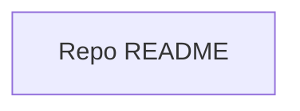

## Stack
- No manifest file found at repo root (no package.json, go.mod, pyproject.toml, or Cargo.toml).
- No source code files present.
- Repo currently contains only README.md and .git — not a code project at this time.

## Directory map
| path | what lives there |
|---|---|
| README.md | Single-line title, "# THE_MEAN" — no other content |
| .git | Git metadata (excluded from documentation scope) |

## Diagram

## Component index
- [[Repo_README]]

## Entry points
- Dev entry point: TODO: verify (no code present)
- Prod entry point: TODO: verify (no code present)

## Conventions
- None observed — repo has no source files to derive conventions from.

## Where things go
- To add the first source files, create them at repo root or in a subfolder and re-run documentation once a manifest (e.g. package.json) exists.
- To establish a stack, add a manifest file (package.json, go.mod, pyproject.toml, or Cargo.toml) matching the intended language/framework.
- To flesh out README.md, expand /Volumes/SIAM/Github Repos/THE_MEAN/README.md beyond the current title-only line.
